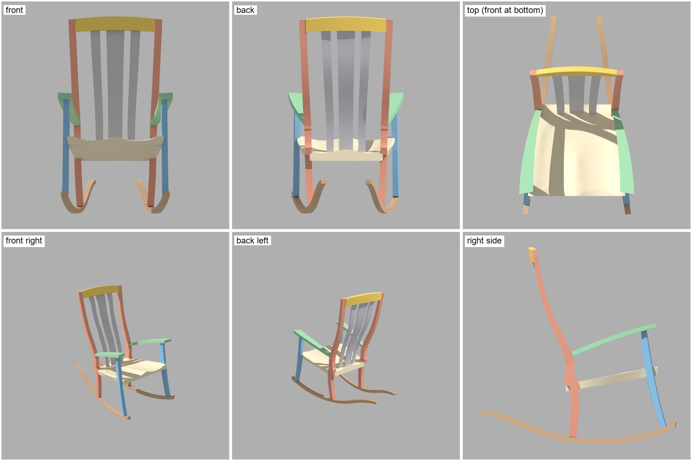
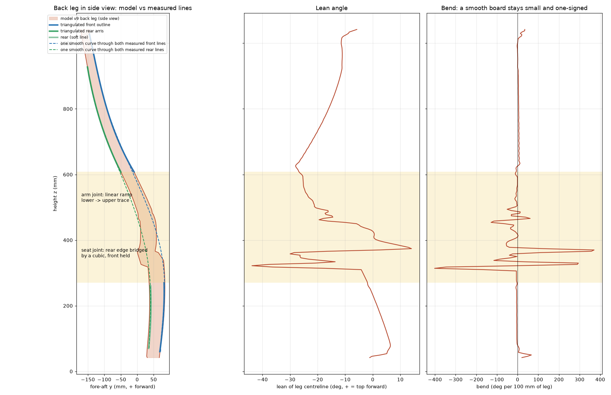
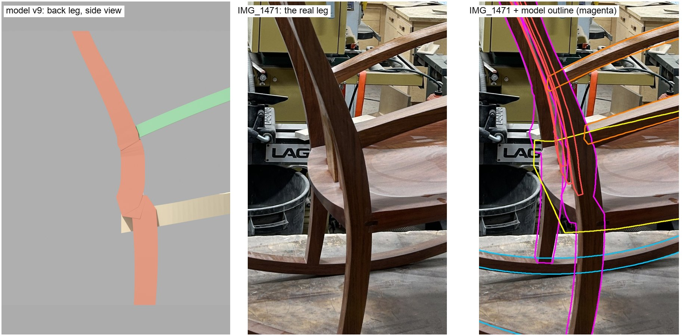
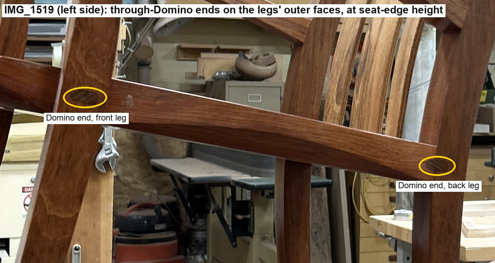
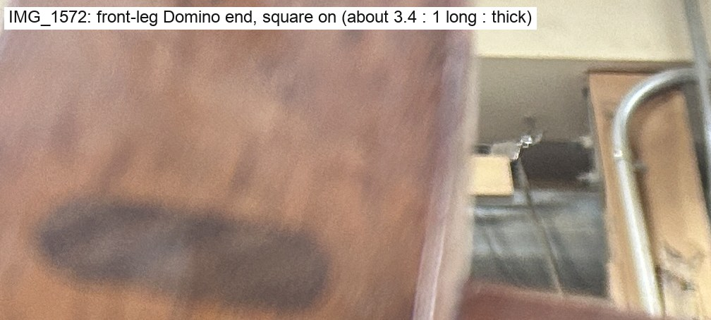
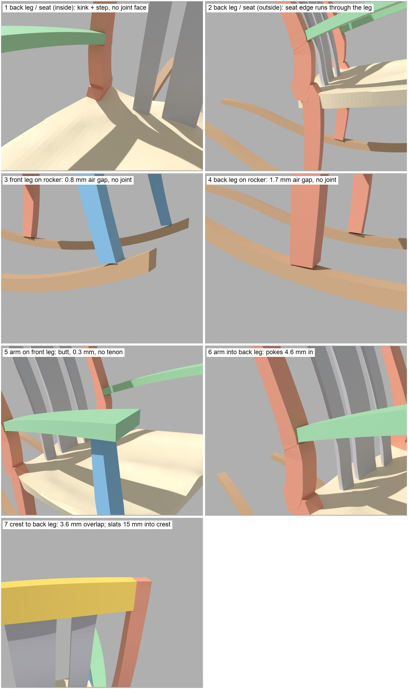
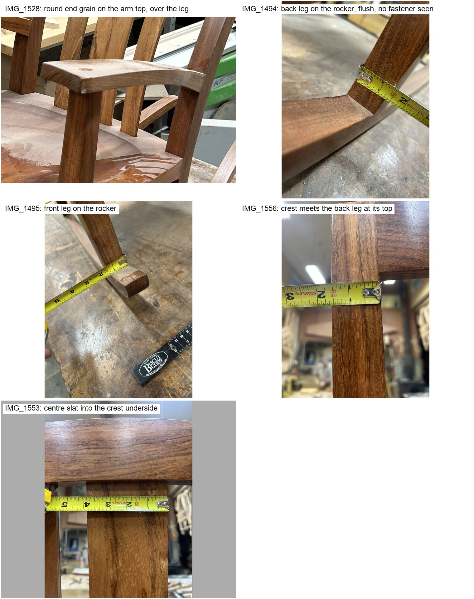
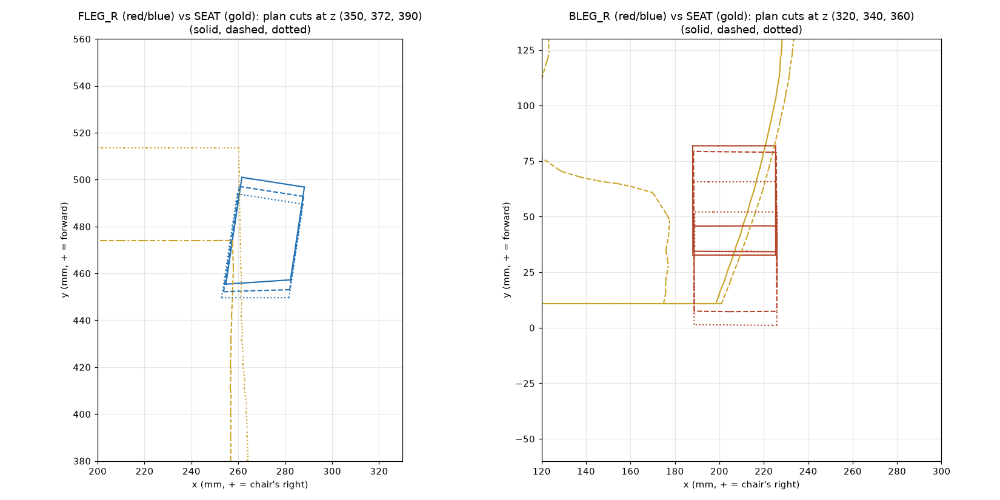

# Model v9 audit: the model against the real chair

Audit of `parts/model_v9.glb` (main @ a97e4c1) against the photos and the triangulated side-frame lines.
v10 on `seat-front` changes only the seat front, so everything here except the seat-front notes still applies.
Frame: mm, +X = chair's right, +Y = forward, +Z = up, table top Z = 0.

## 1. The back leg is not one board

The real back leg is one continuous piece of wood: a smooth sweep from foot to crest (IMG_1471).
The model's leg is stitched from three sources: plane traces below z 470, a cloud/sheet trace above z 608, and a
**linear ramp across z 450–608** (the arm joint), plus a cubic bridge on the rear edge for z 260–446.
All the strangeness lives in the band nobody measured, z 270–608.

| | model v9 | smooth curve through the measured lines |
|---|---|---|
| lean at z 350 / 400 / 500 | −26° / +1.7° / −21° | changes gently |
| bend (deg per 100 mm) | −402 … +370, 20 sign changes | single sweep |
| fore-aft width | balloons to 68 mm at z 350 (41–48 elsewhere) | ~constant |
| max departure from smooth curve | 17.6 mm front edge, 27.2 mm rear edge | — |

One quintic through *both* measured ranges fits the front edge at rms 1.22 mm (max 4.9) and the rear edge at
rms 0.82 mm (max 3.0). The data already describe one board; the build stitched it badly.

## 2. Dominos are missing, and they tell us the seat joint

Every leg shows a dark stadium-shaped end-grain oval on its **outer** face at seat-edge height: left front and
back (IMG_1519), close-up IMG_1572, right side IMG_1488/1471. Aspect ~3.4:1 long to thick (exact size needs a
tape reading). That is a through-Domino: the leg is lapped on the outside of the seat's side edge and a
horizontal Domino runs through the leg into the seat edge. The model has no Dominos and no lap.

## 3. Do the pieces connect like a real build? No.

Measured with `tools/audit_joints.py` (manifold booleans, signed distance; KD-tree for the open seat).

| Joint | Real chair | Model v9 |
|---|---|---|
| Front leg / seat | leg lapped outside seat edge + through-Domino | leg overlaps seat 4–9 mm, no Domino; close to right |
| Back leg / seat | same lap + Domino | seat edge runs **diagonally through** the leg (leg x 188–226, seat edge x 201–228): 33–34 mm of a 38 mm leg is shared wood. Seat outline there is extrapolated (measured only y 110–400) |
| Legs on rockers | faces flush (IMG_1494/1495), hidden fastener | legs **float**: 0.8 mm (front), 1.7 mm (back) gap, zero contact; feet offset ~3 mm in x from rocker faces |
| Arm on front leg | round end grain on arm top over leg (IMG_1528): through round tenon/dowel or plug | butt touch, 0.3 mm penetration, 0.09 cm³ |
| Arm into back leg | arm end let into leg | pokes 4.6 mm in (3.0 cm³); end not shaped to leg face |
| Crest / back legs | crest between legs, joined | 3.6 mm overlap (4.3 cm³), no tenon |
| Slats | tenoned into seat and crest | run 15 mm into crest (20.5 / 11.6 cm³) and 10–14 mm into seat: accidental stub tenons with no mortise |

**Assembly as built:** the seat is the hub. Legs lap and Domino to the seat sides; arms sit on the front legs and
enter the back legs; the crest spans the back legs; slats go into seat and crest; rockers sit under the feet on
hidden joints. The model has no mating faces anywhere, so it cannot be assembled or turned into templates as is.

## 4. Other differences

- SEAT mesh is not watertight (4 open edges): no booleans, no CAD export.
- Every member is a sharp-edged rectangle; the real parts have rounded arrises.
- Assumed, not measured: thickness across of back leg 38, front leg 33, rocker 31, arm 25; seat underside is a flat plane; slats 10 mm.
- Front leg was cut at the arm underside in the build (it ran through the arm), which hides the real joint.
- Not a defect: the 8.5° rocker toe-in matches the photos.
- The IMG_1488 overlay is poorly registered; don't judge from it.

## 5. Proposed fixes (for the model builder)

1. Back leg: one smooth spline per edge through both measured ranges; drop the ramp and the cubic bridge.
2. Seat edge stops at the back-leg inner face; legs lap the seat's outside.
3. Model the joints as bodies: through-Dominos at the four seat laps, arm/front-leg round tenon, arm and crest tenons into the back legs, slat mortises.
4. Seat the leg feet on the rocker tops, flush outer faces.
5. Close the seat mesh.
6. Open: one tape reading of a Domino end (length × thickness) and a leg thickness, to replace assumptions.

## Tools

`tools/audit_joints.py`, `audit_bleg.py`, `audit_sections.py`, `audit_misc.py`, `audit_figs.py`, `audit_crop.py`.
